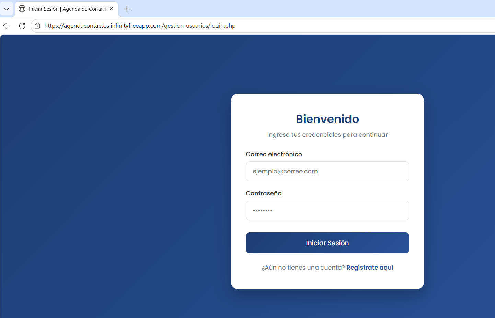
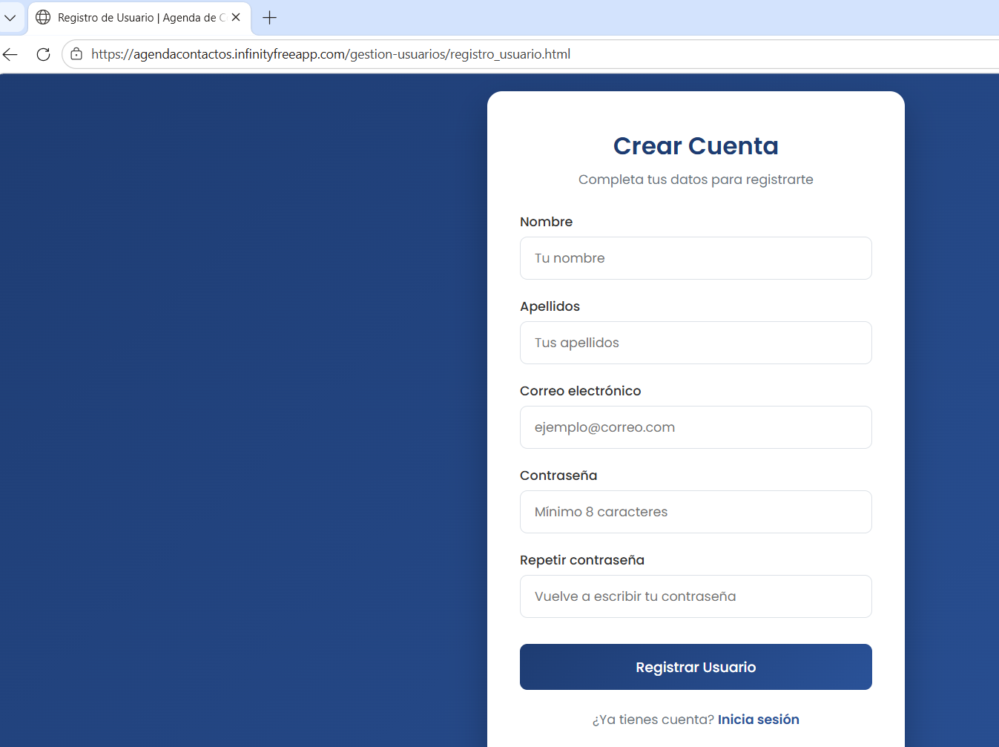
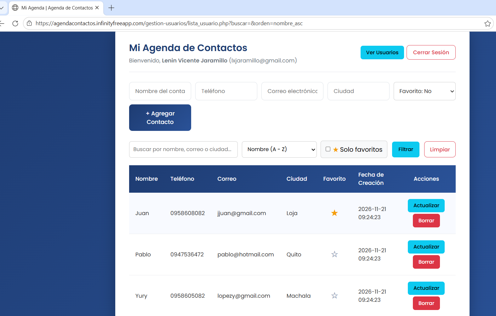
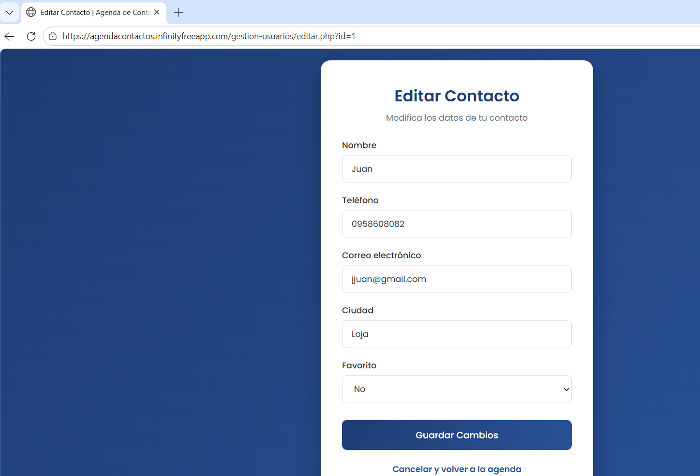

# Agenda de Contactos y Gestión de Usuarios

## 1. Descripción del proyecto
Aplicación web de gestión de agenda personal de contactos desarrollada en PHP y MySQL con sistema de autenticación y control de sesiones. Permite a cada usuario registrarse, iniciar sesión de forma segura y administrar únicamente sus propios contactos (crear, listar, editar y eliminar), garantizando el aislamiento de datos entre usuarios mediante llaves foráneas y validaciones en el servidor.

Incluye medidas de seguridad como encriptación de contraseñas (`password_hash` / `password_verify`), consultas preparadas con `mysqli` para prevenir inyección SQL, escape de salidas HTML (`htmlspecialchars`) contra ataques XSS y control de acceso por sesión y rol administrativo.

---

## 2. Tecnologías utilizadas
* **Backend:** PHP 8.x (extensión `mysqli` y manejo de sesiones `$_SESSION`).
* **Base de datos:** MySQL / usuariosdb.
* **Frontend:** HTML5, CSS3 (diseño responsivo personalizado) y JavaScript (validación de contraseñas en tiempo real, cuadros de confirmación) y JavaScript ES6 (`inactividad.js`).
* **Entorno de servidor:** Apache (XAMPP) y InfinityFree
* **Control de versiones:** Git y GitHub.

---

## 3. Utlización de lenguajes:
* **Lenguajes utilizados:** PHP- 67.2%
* **Lenguajes utilizados:** CSS- 18.8%
* **Lenguajes utilizados:** HTML- 14%

---

## 4. URL pública
La aplicación se encuentra desplegada y operativa en línea en el siguiente enlace:
* **Acceso al sistema:** [https://agendacontactos.infinityfreeapp.com/gestion-usuarios/login.php](https://agendacontactos.infinityfreeapp.com/gestion-usuarios/login.php)

> **Nota para evaluación:** Puede registrar una cuenta nueva directamente desde la opción *"Registrarse"* en la pantalla de inicio o iniciar sesión con un usuario previamente creado.

---

## 5. Capturas de pantalla
### Inicio de sesión y registrar usuario



### Panel principal de contactos y favoritos


### Edición de contactos

---
## 6. Requisitos para su ejecución
* **XAMPP** (o cualquier servidor local equivalente con Apache, PHP y MySQL/MariaDB).
* **PHP** versión 8.0 o superior.
* **MySQL / usuariosdb** activo (configurado en el puerto `3307`, modificable en `conexion.php`).
* **Navegador web** actualizado (Google Chrome, Microsoft Edge, Mozilla Firefox, etc.).
* **Descomprimir el archivo y abrirlo en VS studio o Antigravity ID**

---

## 7. Pasos para instalar la aplicación localmente descaragndo el archivo .zip 

1. **Ubicar el proyecto en el servidor local:**
   Clona este repositorio o copia la carpeta del proyecto dentro del directorio `htdocs` de XAMPP:
   ```bash
   cd C:\xampp\htdocs
   git clone [https://github.com/Lenin2307/ForoAgenda.git](https://github.com/Lenin2307/ForoAgenda.git) agendaContactos

2. **Iniciar los servicios en XAMPP**
* **Abre el Panel de Control de XAMPP**
* **Haz clic en Start en los módulos Apache y MySQL**

3. **Importar la base de datos en phpMyAdmin**
* **Abre tu navegador web e ingresa a phpMyAdmin:** http://localhost/phpmyadmin.
* **En el menú lateral izquierdo, haz clic en Nueva, asigna el nombre usuariosdb (con cotejamiento utf8mb4_general_ci) y presiona Crear.**
+ **Con la base de datos usuariosdb seleccionada, haz clic en la pestaña Importar en el menú superior.**
* **Presiona Seleccionar archivo y elige el script gestion-usuarios/usuariosdb.sql ubicado dentro de la carpeta del proyecto.**
* **Desplázate hasta el final de la página y haz clic en Importar (o Continuar) para generar automáticamente las tablas usuarios y contactos.**

3. **Verificar la conexión a la base de datos**
**Abre el archivo gestion-usuarios/conexion.php en un editor de código y verifica que los parámetros coincidan con tu configuración local de MySQL:**
* **Servidor:** localhost
* **Contraseña:** "" (vacía por defecto en XAMPP)
* **Base de datos:** usuariosdb
* **Puerto:** (si tu instalación de XAMPP utiliza el puerto estándar, cámbialo a 3306)

4. **Cómo acceder a la aplicación**
**Con los servicios de Apache y MySQL activos, abre tu navegador web e ingresa a cualquiera de las siguientes direcciones:**
* **Página principal de bienvenida:** http://localhost/agendaContactos/gestion-usuarios/
* **Registro de usuario nuevo:** http://localhost/agendaContactos/gestion-usuarios/registro_usuario.html
* **Inicio de sesión:** http://localhost/agendaContactos/gestion-usuarios/login.php

5. **Conexión a la base datos local*
Abre el archivo gestion-usuarios/conexion.php y verifica que tenga tus credenciales locales de XAMPP (ajusta el puerto si tu MySQL usa 3307 en lugar de 3306):
**
$servidor = "localhost";
$usuario  = "root";
$clave    = "";
$bd       = "usuariosdb";**

---

## 8. Flujo de la aplicación
* **Accede a Crear Cuenta Nueva (registro_usuario.html) y registra un usuario con un correo válido.**
* **Inicia sesión con tus credenciales desde login.php.**
* **En el panel principal (lista_usuario.php), agrega nuevos contactos, edita los existentes o elimínalos según necesites.**
* **Finaliza tu sesión haciendo clic en el botón Cerrar Sesión.**

---

## 9. Detalle de las mejoras respecto a la versión anterior
En comparación con la versión inicial del sistema (que contaba únicamente con un CRUD básico en entorno local), esta versión incorpora mejoras sustanciales en funcionalidad, seguridad, estructura de base de datos, experiencia de usuario y despliegue en producción:

### 9.1. Sistema de contactos favoritos y filtrado prioritario (`favorito.php` y `lista_usuario.php`)
* **Marcado interactivo de favoritos:** Se integró una estrella dinámica (`★` dorada para favoritos y `☆` para contactos estándar) en cada fila de la agenda. Al hacer clic, se ejecuta `favorito.php` para alternar el estado del registro en la base de datos de forma inmediata.
* **Filtro "Solo favoritos":** Se añadió un control en la vista principal (`lista_usuario.php`) que permite filtrar la consulta SQL (`WHERE favorito = 1`) para mostrar únicamente los contactos destacados, agilizando el acceso a números y correos frecuentes.

### 9.2. Búsqueda multicampo y ordenamiento dinámico (`lista_usuario.php`)
* **Buscador integrado:** Se implementó un filtro de búsqueda que permite localizar contactos mediante coincidencias parciales (`LIKE`) por nombre, correo electrónico o número de teléfono sin necesidad de recorrer toda la tabla manualmente.
* **Ordenamiento flexible:** Se incorporaron opciones para ordenar los registros alfabéticamente (A–Z / Z–A) o cronológicamente según su fecha de registro (`fecha_creacion`), mostrando los contactos más recientes primero.

### 9.3. Seguridad de sesiones y cierre automático por inactividad (`inactividad.js` y `logout.php`)
* **Temporizador de inactividad en el cliente:** Se desarrolló el script `inactividad.js`, el cual monitorea continuamente los eventos de interacción del usuario en el navegador (movimiento del ratón, clics, pulsaciones de teclado y desplazamiento). Si transcurren **30 segundos** sin actividad, redirige automáticamente a `logout.php`.
* **Destrucción limpia de sesión:** `logout.php` vacía las variables de sesión (`$_SESSION`), invalida la cookie de sesión y cierra el acceso, evitando que terceros manipulen la agenda si el usuario deja el equipo desatendido.
* **Protección de rutas privadas:** Todas las vistas internas (`lista_usuario.php`, `editar.php`, `actualizar.php`, `borrar.php`, `favorito.php` y `ver_usuarios.php`) verifican al inicio que exista una sesión activa antes de renderizar contenido o procesar peticiones.

### 9.4. Autenticación robusta y validación de integridad (`guardar_usuario.php` y `login.php`)
* **Cifrado de contraseñas:** Se implementó el almacenamiento seguro de claves mediante `password_hash()` (algoritmo BCRYPT) durante el registro y su validación con `password_verify()` en el inicio de sesión, eliminando el almacenamiento en texto plano.
* **Validación de formato y duplicados:** En `guardar_usuario.php` se validan los campos obligatorios, el formato correcto del correo electrónico (`filter_var` con `FILTER_VALIDATE_EMAIL`) y se verifica que el correo no esté registrado previamente antes de crear la cuenta.
* **Prevención de vulnerabilidades web:** Se incorporó saneamiento de entradas y escape de caracteres en salida (`htmlspecialchars`) para mitigar ataques de inyección SQL y Cross-Site Scripting (XSS).

### 9.5. Evolución del esquema de base de datos (`usuariosdb`)
* **Nuevos atributos en `contactos`:** Se añadieron las columnas `favorito` (`TINYINT(1)` con valor predeterminado `0`) y `fecha_creacion` (`TIMESTAMP` automático) para soportar el filtrado prioritario y el historial cronológico.
* **Aislamiento de datos por usuario:** Cada contacto queda vinculado al identificador del usuario propietario (`usuario_id`), garantizando que cada cuenta registrada administre exclusivamente su propia agenda privada.
* **Soporte completo de caracteres (`utf8mb4`):** Se configuró `$conexion->set_charset("utf8mb4")` en `conexion.php` para almacenar y mostrar correctamente tildes, la letra `ñ` y símbolos especiales sin errores de codificación.

### 9.6. Rediseño de interfaz y experiencia de usuario (`estilos.css`)
* **Jerarquía visual y diseño responsivo:** Se reestructuró `estilos.css` con contenedores centrados, tipografía legible, tablas estilizadas y adaptación a pantallas de escritorio y dispositivos móviles.
* **Acciones diferenciadas y retroalimentación:** Se asignaron colores e indicadores visuales claros para cada operación (agregar, editar, marcar favorito y eliminar con confirmación), además de mensajes informativos ante errores de inicio de sesión o registro.

### 9.7. Despliegue en entorno de producción (`InfinityFree`)
* **Portabilidad de configuración:** Se centralizaron los parámetros de acceso a MySQL en `conexion.php` para permitir la transición directa entre el entorno local (XAMPP) y el servidor remoto.
* **Publicación en línea:** Se migró la aplicación completa y la base de datos relacional al servidor de **InfinityFree**, dejando el sistema operativo y accesible públicamente mediante HTTPS.

### Resumen comparativo de versiones

| Característica | Versión Anterior (Local) | Versión Actual (Desplegada) |
| :--- | :--- | :--- |
| **Entorno de ejecución** | Solo local (`localhost` en XAMPP) | En línea con URL pública (`InfinityFree`) |
| **Gestión de favoritos** | No disponible | Estrella interactiva (`★` / `☆`) y filtro dedicado |
| **Búsqueda y orden** | Listado estático sin filtros | Buscador multicampo y orden alfabético/cronológico |
| **Control de inactividad** | Sesión abierta indefinidamente | Cierre automático tras 30 segundos sin actividad |
| **Seguridad de contraseñas** | Validación básica | Encriptación BCRYPT (`password_hash` / `password_verify`) |
| **Esquema de tabla `contactos`** | Campos básicos de contacto | Incluye `favorito`